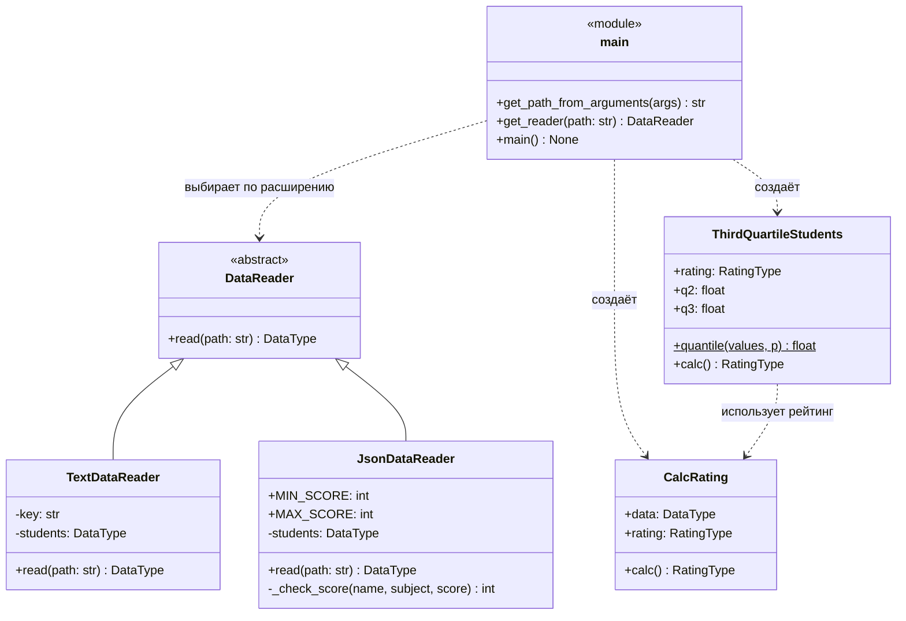

# Лабораторная 1 по дисциплине "Технологии программирования"


**Тема:** знакомство с системой контроля версий Git и инструментом CI/CD GitHub Actions.
**Вариант:** 11.

## Постановка задачи

Проект `rating` рассчитывает средний рейтинг студентов по дисциплинам.
Индивидуальное задание (вариант 11):

1. Выбрать лицензию и добавить файл `LICENSE` в проект.
2. Добавить в проект файл `.gitignore`.
3. Добавить класс-наследник `DataReader`, читающий входной файл формата **JSON**,
   и модульные тесты к нему (ветка `feature/json-reader`).
4. Добавить класс, который **определяет и выводит на экран всех студентов,
   чей рейтинг попадает в третью квартиль распределения по рейтингам**,
   и модульные тесты к нему (ветка `feature/third-quartile`).
5. Составить UML-диаграмму классов итогового проекта.

## Используемые технологии

- Python 3.10, механизм Type Hints;
- pytest и pytest-cov — модульное тестирование и покрытие кода;
- pycodestyle — проверка соответствия стандарту PEP 8;
- Git, GitHub, GitHub Actions — контроль версий и непрерывная интеграция.

## Структура проекта

```
PTLab1
├── .github/workflows/github-actions-testing.yml   # конвейер CI
├── data/
│   ├── data.txt                    # исходные данные (текстовый формат)
│   └── data.json                   # исходные данные (формат JSON, вариант 11)
├── docs/                           # UML-диаграмма и схема веток
├── src/
│   ├── Types.py                    # псевдоним типа DataType
│   ├── DataReader.py               # абстрактный класс «читатель данных»
│   ├── TextDataReader.py           # чтение .txt
│   ├── JsonDataReader.py           # чтение .json            (вариант 11)
│   ├── CalcRating.py               # расчёт среднего рейтинга
│   ├── ThirdQuartileStudents.py    # студенты третьей квартили (вариант 11)
│   └── main.py                     # точка входа
├── test/                           # модульные тесты pytest
├── .gitignore
├── LICENSE                         # MIT
├── README.md
└── requirements.txt
```

## Формат JSON-файла

```json
{
	"Иванов Иван Иванович": { "математика": 80, "программирование": 90, "литература": 76 },
	"Петров Петр Петрович": { "математика": 100, "социология": 90, "химия": 61 }
}
```

Ключ верхнего уровня — ФИО студента, значение — объект «дисциплина: балл».
Балл должен быть целым числом от 0 до 100, иначе выбрасывается `ValueError`.

## UML-диаграмма классов



Та же диаграмма в виде картинки: [docs/uml_class_diagram.png](docs/uml_class_diagram.png).

## Работа с ветками

Каждая часть индивидуального задания выполнялась в отдельной ветке, созданной от `main`.
После прохождения всех тестов в GitHub Actions ветка объединялась с `main`.

## Выводы

1. Освоена работа с распределённой системой контроля версий Git: создание репозитория,
   индексация и фиксация изменений, работа с удалённым репозиторием, ветвление и слияние.
2. Настроен конвейер непрерывной интеграции GitHub Actions: при каждом изменении код
   автоматически проверяется на соответствие PEP 8 и тестируется; намеренно внесённая
   ошибка была обнаружена конвейером.
3. Благодаря абстрактному классу `DataReader` поддержка формата JSON добавлена без
   изменения существующих классов (принцип открытости/закрытости).
4. Реализован расчёт студентов третьей квартили рейтинга; граничные случаи
   (пустые данные, один студент, одинаковые рейтинги, значения на границах Q2 и Q3)
   покрыты тестами.
